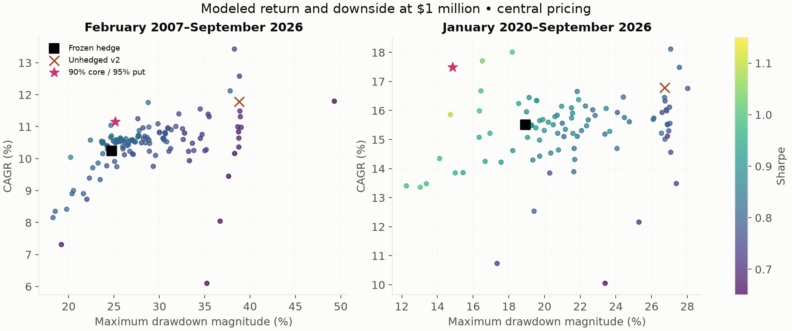

# Can a protective put deliver Sharpe above 1?

Local research on the frozen FearTradeStrategy v2 portfolio through September 11, 2026. The refresh window includes returns from the close of December 31, 2019. All option trades and valuations use a model. Only the ETF closes and volatility-index observations are market data.

**2020–2026 met the objective in the model.** With $1M at the start of 2007, a 90% v2 core target and a 12-month QQQ put struck at 95% delivered 1.070 Sharpe, 17.50% CAGR, and a 14.85% maximum drawdown in the refresh period. The frozen hedge delivered 0.923, 15.51%, and 18.94%. This was the only tested configuration to meet the return, tail-loss and Sharpe criteria in all three pricing scenarios at both whole-contract sizes on the continuous path.

**The full history gives a different answer.** The same candidate delivered 0.855 Sharpe, 11.16% CAGR, and a 25.12% drawdown, compared with the frozen hedge’s 0.805, 10.24%, and 24.73%. The 80% core / 95% put delivered the highest full-history Sharpe at $1M (0.865), with a smaller 20.21% drawdown and 10.04% CAGR. No full-period strategy reached 1.

The 90% target increases the capital allocated to the core. The 95% strike starts protection closer to entry spot. The unhedged 90% core produced 18.12% CAGR in the refresh window, but its drawdown was 27.07% and its Sharpe was 0.799. Adding the 95% put preserved most of that CAGR and cut drawdown by 12.22 points. The extra equity allocation accounts for a meaningful part of the return.

## The threshold in context

The joint target requires Sharpe above 1, CAGR at least as high as the same-date, same-cost frozen hedge, maximum drawdown within two percentage points, and average daily loss in the worst 5% of sessions within 0.10 percentage points. The threshold for CAGR is a research assumption. Raw CAGR and drawdown are provided so a different threshold can be applied.

| Window | Frozen Sharpe | Highest modeled Sharpe | Above 1 at $1M | Meet joint target at $1M | Joint target at both sizes, all prices |
|---|---|---|---|---|---|
| full | 0.805 | 0.865 | 0/134 | 0 | 0 |
| refresh | 0.923 | 1.084 | 5/135 | 2 | 1 |
| quote-era | 0.988 | 1.066 | 11/135 | 3 | 0 |
| late | 0.976 | 1.085 | 11/135 | 3 | 0 |
| early | 0.599 | 0.656 | 0/134 | 0 | 0 |
| 2026-ytd | 1.044 | 1.398 | 122/135 | 71 | 10 |
| data-extension | 1.020 | 1.494 | 121/135 | 68 | 15 |

Counts include correlated strike/maturity combinations and entry-phase diagnostics. Short 2026 windows have fewer than 12 months of data; their annualized metrics are particularly sensitive to individual days. The trial ledger identifies families and periods.

## What changed the portfolio

Central pricing and whole contracts, starting with $1M in 2007. The table reports Sharpe / CAGR / maximum drawdown. An asterisk marks a shorter history for the term-structure gate.

| Rule | Full history | 2020–2026 |
|---|---|---|
| Unhedged v2 | 0.707 / 11.78% / -38.79% | 0.777 / 16.79% / -26.72% |
| Frozen 12m / 85 put | 0.805 / 10.24% / -24.73% | 0.923 / 15.51% / -18.94% |
| Frozen put, tranche proceeds | 0.806 / 10.29% / -24.73% | 0.925 / 15.66% / -18.94% |
| 3-month put | 0.678 / 10.36% / -38.76% | 0.752 / 14.56% / -27.07% |
| 6-month put | 0.786 / 10.68% / -27.62% | 0.822 / 14.69% / -24.06% |
| 18-month put | 0.777 / 9.78% / -24.20% | 0.863 / 14.43% / -19.73% |
| 24-month put | 0.786 / 9.75% / -25.31% | 0.906 / 14.62% / -18.22% |
| 90% strike | 0.815 / 9.71% / -22.65% | 0.957 / 15.08% / -16.34% |
| 95% strike | 0.815 / 9.00% / -20.52% | 0.980 / 14.35% / -14.12% |
| Neither guard nor put | 0.642 / 11.80% / -49.29% | 0.749 / 16.76% / -28.02% |
| Put alone | 0.737 / 10.28% / -35.17% | 0.878 / 15.51% / -20.49% |
| 75% coverage | 0.781 / 10.62% / -28.24% | 0.883 / 15.84% / -20.71% |
| 2% annual gross budget | 0.789 / 10.81% / -30.62% | 0.925 / 16.34% / -19.56% |
| Dynamic coverage | 0.789 / 10.66% / -24.64% | 0.860 / 15.47% / -22.36% |
| Sell half on fear | 0.793 / 10.52% / -27.31% | 0.895 / 15.79% / -20.58% |
| 126-session beta | 0.791 / 10.44% / -26.58% | 0.900 / 15.69% / -19.91% |
| Separate QQQ and SPY puts | 0.802 / 10.29% / -24.27% | 0.892 / 15.21% / -21.60% |
| 85/70 put spread | 0.750 / 10.94% / -32.55% | 0.872 / 16.45% / -19.14% |
| 85/70 spread + 110 call | 0.692 / 9.94% / -33.31% | 0.755 / 13.85% / -20.29% |
| Share-matched spread control | 0.733 / 11.31% / -35.49% | 0.837 / 16.65% / -21.83% |
| Two staggered puts | 0.815 / 10.39% / -24.33% | 0.924 / 15.53% / -18.91% |
| Always eligible | 0.790 / 10.15% / -27.03% | 0.867 / 14.64% / -20.78% |
| SKEW gate | 0.754 / 10.97% / -28.20% | 0.802 / 16.45% / -26.73% |
| VIX/VIX3M gate * | 0.924 / 11.67% / -20.35% | 0.870 / 14.53% / -20.35% |
| 80% core + frozen put | 0.820 / 11.04% / -24.65% | 0.942 / 16.24% / -18.55% |
| 90% core + frozen put | 0.795 / 12.12% / -37.81% | 1.001 / 18.01% / -18.20% |
| 90% core, unhedged | 0.742 / 13.43% / -38.27% | 0.799 / 18.12% / -27.07% |
| 90% core + 90% put | 0.837 / 11.76% / -28.77% | 1.038 / 17.71% / -16.52% |
| 90% core + 95% put | 0.855 / 11.16% / -25.12% | 1.070 / 17.50% / -14.85% |
| 80% core + 90% put | 0.836 / 10.58% / -22.40% | 0.991 / 15.99% / -16.35% |
| 80% core + 95% put | 0.865 / 10.04% / -20.21% | 1.084 / 15.86% / -14.72% |

The VIX/VIX3M rank first becomes available in September 2010. Its deltas use a separately initialized benchmark from that date. The other full-history rows shown start in February 2007.

## Account size and pricing risk

Each range below spans provisional central, higher-skew/wider-spread, and flatter-term pricing. Smaller accounts can skip a trade or be unable to sell half a contract. Whole-contract runs use raw ETF prices and a modeled $0.65 fee per contract per side.

| Rule | Starting NAV | Refresh Sharpe range | Central CAGR | Central drawdown | 90% paired ΔSharpe interval |
|---|---|---|---|---|---|
| Frozen 12m / 85 put | $100,000 | 0.879–0.907 | 15.57% | -19.48% | [+0.000, +0.000] |
| Frozen 12m / 85 put | $1,000,000 | 0.887–0.923 | 15.51% | -18.94% | [+0.000, +0.000] |
| 90% core + frozen put | $100,000 | 0.951–1.000 | 18.06% | -18.37% | [-0.107, +0.328] |
| 90% core + frozen put | $1,000,000 | 0.966–1.001 | 18.01% | -18.20% | [-0.120, +0.313] |
| 90% core + 90% put | $100,000 | 0.989–1.027 | 17.74% | -17.03% | [-0.094, +0.367] |
| 90% core + 90% put | $1,000,000 | 0.992–1.038 | 17.71% | -16.52% | [-0.103, +0.367] |
| 90% core + 95% put | $100,000 | 1.010–1.041 | 17.57% | -15.82% | [-0.090, +0.391] |
| 90% core + 95% put | $1,000,000 | 1.022–1.070 | 17.50% | -14.85% | [-0.090, +0.417] |

The paired intervals use 2,000 moving-block draws of 63 trading sessions. They describe individual comparisons without a multiple-testing correction. Full-period drawdown matching uses hindsight. The late-window prior-fit cash comparison sets the allocation using data through 2016.

## What can be concluded

**A new account in January 2020.** The main refresh table carries holdings, gains and the existing hedge into 2020. Starting from fresh capital and no put on December 31, 2019 changes contract counts and the first entry date. The following results isolate that difference.

| Starting NAV | Central Sharpe | CAGR | Max drawdown | Sharpe across pricings |
|---|---|---|---|---|
| $100,000 | 0.963 | 17.41% | -18.28% | 0.939–0.963 |
| $1,000,000 | 1.029 | 17.81% | -16.55% | 0.998–1.030 |

**Which years mattered.** On the continuous $1M central path, excluding 2020 returns reduced the candidate’s refresh Sharpe to 0.956, and excluding 2023 reduced it to 0.940. Excluding 2022 raised it to 1.313. Each exclusion uses the original portfolio trajectory with one year of returns omitted. This shows how much of the result came from strong years as well as from crash protection.

**What the simpler tests established.** In the full $1M central run, the three-month put left a 38.76% drawdown and the 18-month put cost CAGR. A 95% strike at the original allocation reduced drawdown to 20.52% but cut CAGR to 9.00%. Selling half the put on fear widened drawdown to 27.31%. The 85/70 spread improved CAGR to 10.94% while allowing a 32.55% drawdown. The trend guard and the put each added protection: 49.29% drawdown with neither, 38.79% with the guard alone, 35.17% with the put alone and 24.73% with both.

**Historical episodes.** Central $1M continuous simulation. The trough comes from unhedged v2. Each reported drawdown is the worst peak-to-trough loss in that episode’s peak-to-recovery interval.

| v2 trough | Frozen hedge | 90% core / 95% put |
|---|---|---|
| 2009-03-09 | -24.73% | -25.12% |
| 2011-10-03 | -8.96% | -11.43% |
| 2016-02-11 | -8.88% | -12.25% |
| 2018-12-24 | -12.39% | -10.32% |
| 2020-03-23 | -15.66% | -14.85% |
| 2022-10-14 | -18.94% | -11.51% |
| 2025-04-08 | -11.64% | -11.59% |

**Decision.** Retain the frozen hedge as the benchmark and advance the 90% core / 95% put to listed-quote validation. Under the refresh scenario it delivers more return with a smaller drawdown. Its retrospective selection, the fresh-account test, and the paired uncertainty interval all limit the evidence for treating 1 as its expected Sharpe.

- **maturity** — 6 registered variants. 0 cleared the paired Sharpe, equal-drawdown CAGR and protection checks across both account sizes, all three pricing assumptions and all five long windows.
- **strike** — 6 registered variants. 0 cleared the paired Sharpe, equal-drawdown CAGR and protection checks across both account sizes, all three pricing assumptions and all five long windows.
- **guard** — 2 registered variants. 0 cleared the paired Sharpe, equal-drawdown CAGR and protection checks across both account sizes, all three pricing assumptions and all five long windows.
- **coverage** — 5 registered variants. 0 cleared the paired Sharpe, equal-drawdown CAGR and protection checks across both account sizes, all three pricing assumptions and all five long windows.
- **budget** — 3 registered variants. 0 cleared the paired Sharpe, equal-drawdown CAGR and protection checks across both account sizes, all three pricing assumptions and all five long windows.
- **exit** — 9 registered variants. 0 cleared the paired Sharpe, equal-drawdown CAGR and protection checks across both account sizes, all three pricing assumptions and all five long windows.
- **basis** — 4 registered variants. 0 cleared the paired Sharpe, equal-drawdown CAGR and protection checks across both account sizes, all three pricing assumptions and all five long windows.
- **structure** — 8 registered variants. 0 cleared the paired Sharpe, equal-drawdown CAGR and protection checks across both account sizes, all three pricing assumptions and all five long windows.
- **ladder** — 47 registered variants. 0 cleared the paired Sharpe, equal-drawdown CAGR and protection checks across both account sizes, all three pricing assumptions and all five long windows.
- **gate** — 5 registered variants. 0 cleared the paired Sharpe, equal-drawdown CAGR and protection checks across both account sizes, all three pricing assumptions and all five long windows.
- **core-weight** — 4 registered variants. 0 cleared the paired Sharpe, equal-drawdown CAGR and protection checks across both account sizes, all three pricing assumptions and all five long windows.
- **allocation-strike** — 4 registered variants. 2 cleared the paired Sharpe, equal-drawdown CAGR and protection checks across both account sizes, all three pricing assumptions and all five long windows.

The allocation/strike interaction was added after observing the initial single-factor results. The full 80%/90% allocation by 90%/95% strike follow-up is disclosed. The core-weight control rows isolate how much return came from owning more equity. An increase in a retrospectively selected subperiod remains exploratory.

## Reproduction and limits

From `options/protective_put/`, run `python -m pytest tests`, `python research/options_experiments.py`, `python research/put_refresh_checks.py`, `python research/put_decline_checks.py`, and `python research/put_report.py`. Outputs go to `results/extensions/`. The registry and runner are in `research/options_experiments.py`. All window statistics are in `trials.csv.gz`, all baseline drawdown episodes in `declines.csv.gz`, and every central-price leg trade in `central_ledger.csv.gz`. The plain CSV scorecard supports filtering by cell, family, account size and period.

The simulation preserves next-close execution, funded purchases, T-bill proceeds and the existing minimum fill rule. Maturity rolls when one third of tenor remains. Budgets constrain trailing 365-day gross purchase spend relative to trade-date NAV. The primary 2×2 guard ablation keeps the QQQ trend sleeve invested with the guard disabled. Ladder phases delay initial entry by zero to eleven months and permit cash during startup. A continuous-strike zero-debit collar is a theoretical diagnostic. Collars limit calls to QQQ shares, model European settlement and omit American early assignment. SPY uses VIX and the same provisional surface parameters. Short-leg offset and net hedge P&L are distinct from gross long premium. Liquidation drawdown includes the modeled cost of closing every leg.

Prices for the whole-contract sizing experiment come from the public Yahoo Finance daily chart histories for QQQ and SPY, using the Close field. Cboe supplied SKEW and VIX3M. VIX3M is an S&P volatility proxy. The affordability of a particular listed QQQ put requires its actual ask. [Cboe VIX3M history](https://cdn.cboe.com/api/global/us_indices/daily_prices/VIX3M_History.csv) · [Cboe SKEW history](https://cdn.cboe.com/api/global/us_indices/daily_prices/SKEW_History.csv)

No QuantConnect cloud backtest or real-option fill validation was performed. The quote audit is in `qc/options_quote_audit.ipynb`. It requires QuantBook access to listed option history. The source branch records the US equity-options audit window as starting in 2012; 2008 remains model-only. The branch’s original annualized risk-free series and synthetic QLD returns are retained for comparability. Confirm the executable ask, stress bids, assignment and realized account sizing before adopting an overlay. [QuantConnect option history](https://www.quantconnect.com/docs/v2/writing-algorithms/datasets/algoseek/us-equity-options)

## Checks ported from the options-put-hedge branch

**Does the edge survive without each decline?** For every registered cell, the full-history Sharpe difference against the frozen hedge is recomputed with each of unhedged v2's seven declines (peak to recovery) left out in turn, at both whole-contract sizes under all three pricing assumptions (`research/put_decline_checks.py`, `decline_checks.csv`). The year exclusions above test the Sharpe level; this tests the edge over the benchmark. Central pricing, $1M:

| Rule | Full-history ΔSharpe | Decline whose removal hurts most | ΔSharpe without it | Declines left out with the edge intact |
|---|---|---|---|---|
| 80% core + 95% put | +0.060 | Dec 2021–Nov 2023 | -0.007 | 6/7 |
| 80% core + 90% put | +0.031 | Dec 2021–Nov 2023 | -0.003 | 6/7 |
| 90% core + 95% put | +0.049 | Dec 2021–Nov 2023 | -0.025 | 6/7 |
| 90% core + 90% put | +0.032 | Dec 2021–Nov 2023 | -0.034 | 6/7 |
| 80% core + frozen put | +0.015 | Dec 2021–Nov 2023 | -0.006 | 6/7 |
| 90% strike | +0.010 | Dec 2021–Nov 2023 | -0.001 | 6/7 |
| 95% strike | +0.010 | Dec 2021–Nov 2023 | -0.007 | 6/7 |
| Two staggered puts | +0.010 | Oct 2007–Oct 2010 | +0.001 | 7/7 |

The cells that cleared the all-window checks above (80% core + 90% put, 80% core + 95% put) lose their edge when the Dec 2021–Nov 2023 decline is left out. 0 of 138 registered cells keep a positive edge with every decline left out at both account sizes under all three pricings. Among the 52 cells with a positive central $1M edge, the decline whose removal hurts most is Oct 2007–Oct 2010 for 42, Dec 2021–Nov 2023 for 9, Feb 2025–May 2025 for 1. The leading allocation/strike candidates therefore rest on the 2022 bear market. That episode falls inside the listed-quote era, so the quote audit can test it directly.

**Gates against a same-day benchmark.** Feature gates start when their feature first exists. The VIX/VIX3M row in the portfolio table starts in September 2010, so its Sharpe is not comparable with rows that start in February 2007. Against a frozen hedge started the same day, central pricing, $1M:

| Gate | Start | Gate Sharpe | Frozen hedge, same start | ΔSharpe |
|---|---|---|---|---|
| Always eligible | 2007-02-01 | 0.790 | 0.805 | -0.015 |
| VXN-rank gate | 2007-02-01 | 0.722 | 0.805 | -0.083 |
| Volatility-premium gate | 2007-02-01 | 0.749 | 0.805 | -0.056 |
| VIX/VIX3M gate | 2010-09-17 | 0.924 | 0.954 | -0.030 |
| SKEW gate | 2007-02-01 | 0.754 | 0.805 | -0.051 |

**Quote dates in the audit notebook.** QuantConnect stamps a daily bar at its end time, which can be midnight after the session. `chain_on` now takes the timestamp minus one minute as the session date before requiring the exact trade session, so a midnight stamp no longer empties every audit.

Reproduce this section with `python research/put_decline_checks.py`, then `python research/put_report.py`.
